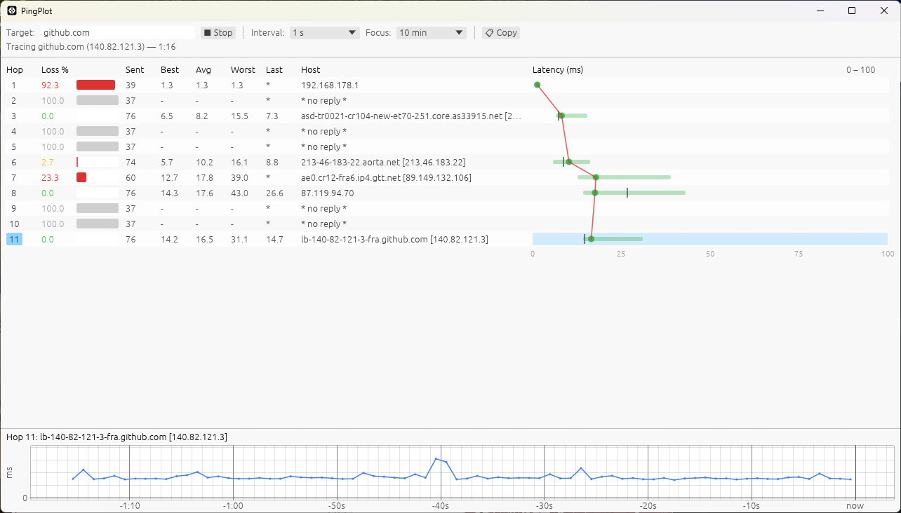

# PingPlot

PingPlotter-style traceroute/ping monitor for Windows, Linux and macOS. Single binary, no service,
no admin/root rights. Windows uses the ICMP API `IcmpSendEcho` (like WinMTR); Linux and macOS use
unprivileged ICMP datagram sockets.

Linux needs your group in `net.ipv4.ping_group_range` (the default on most distributions and WSL;
check with `sysctl net.ipv4.ping_group_range`). macOS support is untested.



Features: per-hop loss and latency stats, latency graph across hops, timeline for the selected hop,
adjustable interval and focus period, copy results as text.

Some routers (e.g. many home routers) rarely answer traceroute probes and show false loss. Tick
**Direct ping hops** to also ping each hop's address directly (like `pathping`); a hop then counts as
answering if it replies to either the traceroute probe or the direct ping.

## Usage

```
pingplot [host]
```

## Build (from Linux/WSL, no Microsoft toolchain)

Requires Rust (rustup, target `x86_64-pc-windows-gnu`), Zig (`pip install ziglang`) and `cargo-zigbuild`.

```
cargo zigbuild --release --target x86_64-pc-windows-gnu
```

Output: `target/x86_64-pc-windows-gnu/release/pingplot.exe`.
Console engine test: `cargo zigbuild --release --target x86_64-pc-windows-gnu --example trace`.

## Build for Linux / macOS

```
cargo build --release
```

Output: `target/release/pingplot`. Runs under WSLg on WSL2.

## License

MIT, see [LICENSE](LICENSE).
